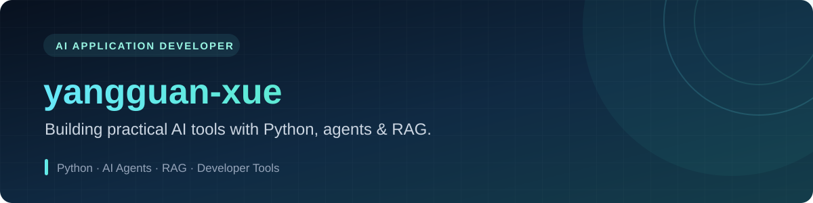

  

  
  
  

## About

Building practical AI tools and backend systems.

- Focused on **AI applications, agents, RAG, and developer tools**.
- Working with **Python, FastAPI, Vue 3, TypeScript, and Spring Boot**.
- Interested in turning ideas into useful, reliable products.

## Featured Work

<table>
  <tr>
    <td width="50%">
      <h3><a href="https://github.com/yangguan-xue/Voice-code">Voice-code</a></h3>
      
Voice-driven AI coding assistant with CLI, TUI, and real-time voice interaction.

      
<code>Python</code> <code>LLM</code> <code>Voice</code> <code>CLI/TUI</code>

      <a href="https://voice-code.yangguanxue.top">Live demo →</a>
    </td>
    <td width="50%">
      <h3><a href="https://yangguanxue.top">Personal Blog</a></h3>
      
Full-stack personal platform for publishing, projects, and experiments.

      
<code>React</code> <code>Spring Boot</code> <code>MySQL</code>

      <a href="https://yangguanxue.top">Visit website →</a>
    </td>
  </tr>
  <tr>
    <td width="50%">
      <h3><a href="https://gitee.com/yangguan-xue/weather">WeatherReport</a></h3>
      
Weather service combining a Spring Boot backend with a WeChat Mini Program.

      
<code>Java</code> <code>Spring Boot</code> <code>Mini Program</code>

      <a href="https://gitee.com/yangguan-xue/weather">View project →</a>
    </td>
    <td width="50%">
      <h3>What I'm Exploring</h3>
      
Practical agent systems, retrieval-augmented generation, and model customization.

      
<code>Agents</code> <code>RAG</code> <code>LoRA</code>

      Always learning by building.
    </td>
  </tr>
</table>

## Engineering Toolbox

  
  
  
  
  
  
  
  
  
  

## Beyond the Code

I enjoy studying how mature systems are designed, breaking them down, and rebuilding the interesting parts. My notes cover AI engineering, backend development, system design, and the lessons collected along the way.

  <strong>Build something useful. Make it reliable. Keep learning.</strong>

